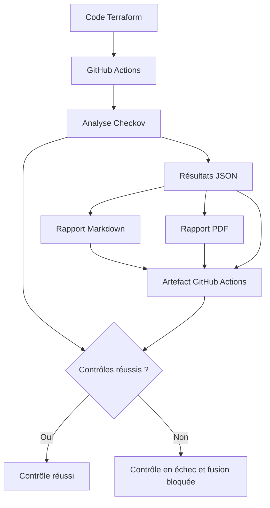

# Policy as Code — Contrôles de sécurité cloud avec Checkov

Automatisation de contrôles de sécurité sur des fichiers Terraform, avec génération de rapports lisibles et intégration à GitHub Actions.

> **Périmètre du projet :** cette démonstration exécute trois contrôles Checkov dans un contexte de bonnes pratiques de sécurité cloud associées à ISO/IEC 27017 et ISO/IEC 27018. Elle ne démontre pas, à elle seule, la conformité complète à ces normes ni une certification ISO.

## Objectifs

- Analyser automatiquement des configurations Terraform avec Checkov.
- Détecter des configurations cloud potentiellement risquées avant la fusion d'une Pull Request.
- Expliquer les résultats en français et proposer des actions correctives.
- Générer un rapport PDF, un rapport Markdown et conserver les résultats JSON de Checkov.
- Publier les livrables dans un artefact GitHub Actions, y compris lorsque les contrôles détectent des violations.
- Bloquer la fusion lorsque le contrôle obligatoire échoue.

## Fonctionnement général

1. Une Pull Request est ouverte ou mise à jour.
2. GitHub Actions installe Checkov et ReportLab.
3. Checkov analyse le dossier `terraform/` et enregistre les résultats dans `checkov-results.json`.
4. Les scripts de `scripts/` génèrent les rapports Markdown et PDF à partir du JSON et de `policies/control-mapping.json`.
5. GitHub Actions publie le PDF, le Markdown et le JSON dans un artefact téléchargeable.
6. L'étape finale fait échouer le contrôle si Checkov détecte des violations, si la génération des rapports échoue ou si l'artefact ne peut pas être publié.

Le workflow est déclenché sur les Pull Requests et lors d'un push sur la branche `main`.

### Schéma simplifié



## Contrôles de sécurité sélectionnés

| Identifiant Checkov | Vérification | Risque à examiner |
|---|---|---|
| `CKV_AWS_24` | Aucun groupe de sécurité ne doit autoriser SSH depuis `0.0.0.0/0` sur le port 22. | Exposition du service d'administration à Internet. |
| `CKV2_AWS_5` | Les groupes de sécurité doivent être associés à une ressource. | Groupe de sécurité potentiellement inutilisé ou configuration incomplète. |
| `CKV2_AWS_61` | Un bucket S3 doit disposer d'une configuration de cycle de vie. | Politique de conservation et coûts de stockage à examiner selon le besoin métier. |

Les priorités affichées dans les rapports sont définies par le projet ; elles ne sont pas des niveaux de sévérité officiels de Checkov. Une correspondance marquée « À vérifier » doit être validée à partir des éditions de référence et des exigences applicables. Un échec Checkov n'établit pas automatiquement une violation d'une clause ISO.

## Structure du dépôt

```text
.
├── .github/
│   └── workflows/
│       └── compliance-check.yml
├── policies/
│   └── control-mapping.json
├── scripts/
│   ├── generate_pdf_report.py
│   └── generate_report.py
├── terraform/
│   └── conforme/
│       ├── good-s3.tf
│       └── good-vpc.tf
├── tests/
│   └── fixtures/
│       └── non-compliant/
│           ├── combined-violations.tf
│           ├── demo-violation.tf
│           ├── public-ssh-unattached.tf
│           └── s3-no-lifecycle.tf
├── docs/
│   ├── images/
│   │   ├── 01-test-non-conforme-terminal.png
│   │   ├── 02-test-non-conforme-github.png
│   │   ├── 03-test-conforme-terminal.png
│   │   └── 04-test-conforme-github.png
│   └── evidence/
│       ├── rapport-non-conforme.pdf
│       └── rapport-conforme.pdf
├── .gitignore
└── README.md
```

Les dossiers `docs/images/` et `docs/evidence/` sont réservés aux captures et aux rapports de démonstration que tu ajouteras. Crée-les si nécessaire. Les noms de fichiers doivent correspondre exactement aux chemins utilisés dans ce README.

### Rôle des principaux chemins

- `.github/workflows/compliance-check.yml` : définit le pipeline GitHub Actions.
- `policies/control-mapping.json` : contient les explications, risques, recommandations et états de validation des correspondances ISO.
- `scripts/generate_report.py` : génère le rapport Markdown.
- `scripts/generate_pdf_report.py` : génère le rapport PDF.
- `terraform/conforme/` : contient les exemples destinés à réussir les contrôles sélectionnés.
- `tests/fixtures/non-compliant/` : conserve les configurations volontairement non conformes pour les tests. Ce dossier n'est pas analysé par le scan normal du workflow.
- `docs/images/` : contient les quatre captures utilisées dans la démonstration.
- `docs/evidence/` : contient les rapports PDF de démonstration, l'un issu d'un scan non conforme et l'autre d'un scan conforme.

Tous les chemins de ce README sont relatifs à la racine du dépôt. En Markdown, utiliser `/` même lorsque le projet est développé sous Windows.

## Prérequis pour une exécution locale

- Python 3.12, pour correspondre à l'environnement du workflow GitHub Actions.
- Git pour gérer les versions du projet.
- Un environnement Python virtuel avec Checkov et ReportLab.

À la racine du dépôt, active l'environnement virtuel, puis installe les versions utilisées dans le workflow :

```cmd
python -m pip install checkov==3.3.27 reportlab==4.4.9
```

## Exécuter le scan normal et générer les rapports

Le scan normal porte sur les configurations présentes dans `terraform/` :

```cmd
checkov -d terraform/ --framework terraform --check CKV_AWS_24,CKV2_AWS_5,CKV2_AWS_61 --output cli --output json --output-file-path console,checkov-results.json --compact
```

Si Checkov détecte une violation, il peut retourner un code de sortie non nul. Cela indique que des contrôles ont échoué, pas nécessairement que les scripts de génération des rapports ont échoué.

Générer le rapport Markdown :

```cmd
python scripts\generate_report.py --input checkov-results.json --mapping policies\control-mapping.json --output reports\compliance-report.md
```

Générer le rapport PDF :

```cmd
python scripts\generate_pdf_report.py --input checkov-results.json --mapping policies\control-mapping.json --output reports\compliance-report.pdf
```

Les fichiers générés localement et le JSON brut sont des résultats de scan ; ils n'ont généralement pas besoin d'être versionnés. Le workflow GitHub publie ces fichiers dans son artefact. Les deux PDF conservés sous `docs/evidence/` sont des copies sélectionnées à des fins de démonstration et de portfolio.

## Démonstration des deux scénarios

Cette section contient quatre emplacements de captures : une capture du terminal et une capture GitHub pour chaque scénario. Ajoute tes propres captures dans `docs/images/` avec les noms indiqués ci-dessous. Les images ne sont pas incluses automatiquement : elles doivent être ajoutées au dépôt.

### Scénario 1 — Configuration non conforme

Le test négatif sert à vérifier que les contrôles détectent bien des configurations dangereuses. Pour relancer un test local sur les exemples non conformes :

```cmd
checkov -d tests/fixtures/non-compliant/ --framework terraform --check CKV_AWS_24,CKV2_AWS_5,CKV2_AWS_61 --output cli --compact
```

Un ou plusieurs échecs sont attendus avec ces exemples. Ce test local vérifie les fixtures ; il est distinct de l'exécution GitHub historique décrite ci-dessous.

**Capture 1 — Terminal : exécution du test non conforme**

Montre la commande lancée sur `tests/fixtures/non-compliant/` et les échecs Checkov dans le terminal.


**Capture 2 — GitHub : workflow en échec et fusion bloquée**

Utilise l'exécution GitHub historique où `terraform/demo-violation.tf` se trouvait temporairement dans le dossier analysé. Elle a détecté deux échecs et a bloqué la fusion. Le fichier de démonstration a ensuite été déplacé dans `tests/fixtures/non-compliant/` afin que le scan normal puisse réussir.


**Rapport PDF non conforme :** [Consulter le rapport de l'exécution non conforme](docs/evidence/rapport-non-conforme.pdf)

Ce rapport doit être la copie PDF téléchargée depuis l'artefact de l'exécution GitHub qui a détecté les deux échecs. Il faut le déposer sous `docs/evidence/rapport-non-conforme.pdf`.

### Scénario 2 — Configuration conforme

Le scan normal doit porter sur le dossier `terraform/`, qui contient les exemples destinés à réussir les trois contrôles sélectionnés :

```cmd
checkov -d terraform/ --framework terraform --check CKV_AWS_24,CKV2_AWS_5,CKV2_AWS_61 --output cli --compact
```

Le résultat attendu est de trois contrôles réussis et zéro contrôle échoué. Le workflow GitHub correspondant au commit `fe0d01b5dbd3` a produit un rapport avec **3 contrôles réussis et 0 échec**.

**Capture 3 — Terminal : scan conforme et envoi des changements**

Montre la sortie du scan local avec `Passed checks: 3, Failed checks: 0`. Si la capture permet de le faire lisiblement, montre également la commande `git push` qui a envoyé les changements conformes sur la branche de travail.


**Capture 4 — GitHub : workflow réussi**

Montre l'exécution verte associée au commit conforme, avec le contrôle obligatoire réussi et l'artefact de rapports disponible.


**Rapport PDF conforme :** [Consulter le rapport de l'exécution conforme](docs/evidence/rapport-conforme.pdf)

Ce rapport doit être la copie PDF téléchargée depuis l'artefact de l'exécution GitHub où les trois contrôles ont réussi. Il faut le déposer sous `docs/evidence/rapport-conforme.pdf`.

### Résultats à retenir

| Scénario | Résultat Checkov | Résultat du workflow |
|---|---|---|
| Configuration non conforme | Au moins un contrôle échoue | Le contrôle obligatoire échoue et la fusion est bloquée. |
| Configuration conforme | 3 réussis, 0 échoué | Le workflow réussit et les rapports sont téléchargeables. |

Les résultats affichés dans les deux rapports proviennent de deux exécutions différentes. Le rapport non conforme documente le test négatif historique ; le rapport conforme documente le scan effectué après le déplacement du fichier de démonstration hors de `terraform/`.

## Lire les livrables

- **PDF :** rapport synthétique adapté à une revue ou à une présentation.
- **Markdown :** rapport textuel lisible directement dans GitHub.
- **JSON :** résultats structurés de Checkov, utiles pour le diagnostic ou un traitement automatisé.

Le rapport est généré à partir du scan ; ce n'est pas un document statique. La réussite de génération du PDF ne signifie pas que les contrôles de sécurité ont réussi : le résultat de conformité dépend du résultat Checkov.

## Limites connues

- Le projet exécute uniquement les trois contrôles Checkov explicitement sélectionnés.
- Les correspondances ISO doivent être vérifiées avant de revendiquer une correspondance normative précise.
- Un pipeline vert ne prouve ni la conformité complète d'une infrastructure ou d'une organisation ni une certification ISO.
- Les exemples de `tests/fixtures/non-compliant/` servent à la démonstration ; ils ne remplacent pas encore une suite de tests automatisés intégrée au workflow principal.

## Conclusion

Ce projet démontre comment intégrer des contrôles de sécurité cloud au processus de développement avec Terraform, Checkov et GitHub Actions, et comment rendre les résultats plus faciles à comprendre grâce à des rapports PDF, Markdown et JSON. Son périmètre reste volontairement limité et ses correspondances normatives ISO doivent être validées séparément.
