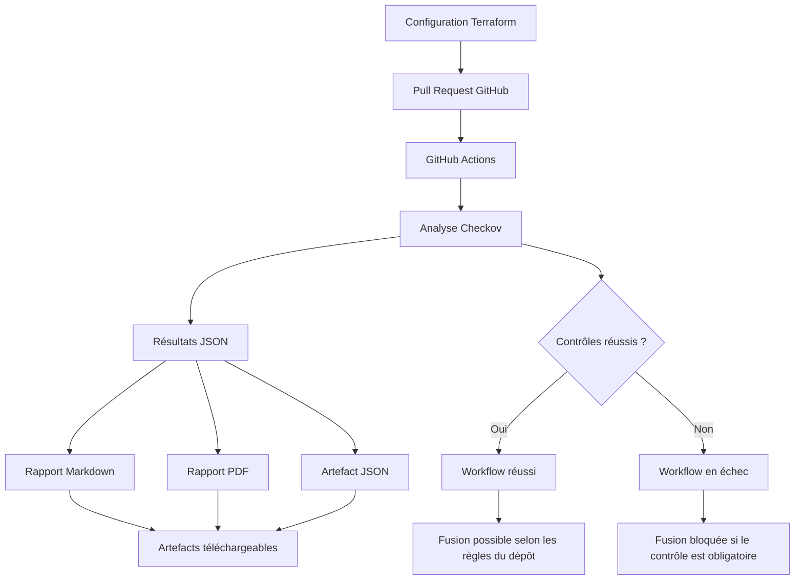

# Policy as Code — Automatisation des contrôles de sécurité Cloud

**Projet de sécurité Cloud | Terraform · Checkov · GitHub Actions · ISO/IEC 27017 & ISO/IEC 27018**

## 1. Présentation du projet

Ce projet met en œuvre une approche **Policy as Code** afin d’automatiser la vérification de configurations d’infrastructure Cloud définies avec Terraform.

L’objectif est d’intégrer des contrôles de sécurité directement dans le cycle de développement. Lorsqu’une Pull Request est créée ou mise à jour sur GitHub, un workflow GitHub Actions lance une analyse avec Checkov, génère des rapports de conformité et détermine si les contrôles sélectionnés sont respectés.

Deux scénarios sont étudiés : une configuration conforme aux contrôles implémentés et une configuration contenant des violations de sécurité.

## 2. Objectifs

- Automatiser l’analyse de configurations Terraform avec Checkov.
- Détecter les mauvaises configurations avant la fusion d’une Pull Request.
- Intégrer les contrôles de sécurité dans un pipeline CI/CD.
- Produire des rapports Markdown et PDF compréhensibles et exploitables.
- Conserver les résultats détaillés de l’analyse au format JSON.
- Empêcher la fusion d’une Pull Request lorsque les vérifications obligatoires échouent.

## 3. Architecture et fonctionnement

Le processus repose sur les étapes suivantes :

1. Une modification de l’infrastructure Terraform est soumise via une Pull Request.
2. GitHub Actions déclenche automatiquement le workflow de sécurité.
3. Checkov analyse les fichiers Terraform et identifie les contrôles réussis ou échoués.
4. Les résultats sont exportés au format JSON.
5. Des scripts Python exploitent ces résultats pour générer les rapports Markdown et PDF.
6. Les rapports et les résultats JSON sont publiés comme artefacts téléchargeables du workflow.
7. Le statut final du pipeline indique si les contrôles sélectionnés sont respectés.

### Schéma du workflow



## 4. Contrôles de sécurité implémentés

Le projet utilise trois contrôles Checkov sélectionnés pour illustrer des vérifications de sécurité Cloud.

| Identifiant | Contrôle | Risque recherché |
|---|---|---|
| `CKV_AWS_24` | Vérification des règles d’entrée SSH | Exposition potentielle de l’accès SSH à Internet |
| `CKV2_AWS_5` | Association des groupes de sécurité aux ressources | Groupe de sécurité non associé à une ressource |
| `CKV2_AWS_61` | Configuration du cycle de vie des objets S3 | Absence de configuration de cycle de vie pour un bucket S3 |

Ces contrôles s’inscrivent dans une démarche de sécurisation des infrastructures Cloud, en lien avec les thèmes abordés par ISO/IEC 27017 et ISO/IEC 27018.

**Périmètre de conformité :** le projet illustre l’automatisation de contrôles techniques sélectionnés. La correspondance avec les exigences ISO doit être validée et documentée ; les résultats ne constituent pas une preuve de conformité complète ni une certification ISO.

## 5. Démonstration — Scénario A : configuration conforme

Ce scénario vérifie le comportement du pipeline lorsqu’une modification est soumise avec une configuration respectant les contrôles de sécurité exécutés.

### Étape 1 — Préparation et publication de la modification

La modification est enregistrée dans Git, puis publiée sur la branche `demo/test-conforme` afin de lancer une nouvelle vérification via une Pull Request.

**Capture 1 — Commandes Git et publication de la branche**


### Étape 2 — Vérification de la Pull Request

Les vérifications GitHub Actions se terminent avec succès. Les contrôles configurés sont respectés pour cette analyse.

**Capture 2 — Pull Request avec vérifications réussies**


### Étape 3 — Résultats du workflow et artefacts

Le workflow `test: rerun compliant scan` se termine avec succès. Les artefacts générés sont disponibles au téléchargement, notamment les rapports et les résultats JSON.

**Capture 3 — GitHub Actions et artefacts téléchargeables**


### Rapport de conformité — PDF

Le rapport présente les résultats de l’analyse et permet de conserver une preuve documentaire de cette exécution.

**Rapport conforme :** 

[compliance-report.pdf](https://github.com/user-attachments/files/33516458/compliance-report.pdf)


Résultats observés lors de cette exécution :

- 3 contrôles réussis ;
- 0 contrôle échoué ;
- 0 contrôle ignoré ;
- 0 erreur d’analyse signalée.

Ces résultats concernent uniquement les contrôles et les ressources examinés pendant cette exécution.

## 6. Démonstration — Scénario B : configuration non conforme

Ce scénario introduit volontairement une configuration présentant des violations de sécurité afin de vérifier la capacité du pipeline à les détecter et à signaler l’échec.

### Étape 1 — Préparation et publication de la configuration de test

Une configuration contenant une violation est ajoutée, puis publiée sur la branche `demo/test-non-conforme`. Une Pull Request déclenche l’analyse automatisée.

**Capture 4 — Commandes Git et publication de la branche**


### Étape 2 — Détection des violations

Les contrôles configurés détectent les problèmes présents dans la configuration. Les vérifications échouent et la fusion est bloquée lorsque le contrôle correspondant est obligatoire dans les règles du dépôt.

**Capture 5 — Pull Request avec vérifications échouées**


### Étape 3 — Consultation du workflow et des artefacts

Le workflow `test: verify detection of security violations` se termine en échec. Les rapports restent néanmoins disponibles si l’étape de publication des artefacts est exécutée malgré cet échec.

**Capture 6 — GitHub Actions en échec et artefacts téléchargeables**


### Rapport de non-conformité — PDF

Le rapport détaille les résultats de l’analyse et identifie les contrôles ayant échoué.

**Rapport non conforme :** 

[compliance-report.pdf](https://github.com/user-attachments/files/33516821/compliance-report.pdf)

Résultats observés lors de cette exécution :

- 3 contrôles réussis ;
- 2 contrôles échoués ;
- 0 contrôle ignoré ;
- 0 erreur d’analyse signalée.

Les violations détectées concernent notamment `CKV_AWS_24` et `CKV2_AWS_5`.

## 7. Comparaison des deux scénarios

| Élément observé | Scénario conforme | Scénario non conforme |
|---|---|---|
| Analyse Checkov | Contrôles respectés | Violations détectées |
| Statut du workflow | Réussi | Échec |
| Vérifications de la Pull Request | Réussies | Échouées |
| Fusion | Possible selon les règles du dépôt | Bloquée si le contrôle est obligatoire |
| Rapports générés | Disponibles | Disponibles si leur génération et publication aboutissent |
| Résultats JSON | Conservés parmi les artefacts | Conservés parmi les artefacts |

La comparaison démontre le rôle du pipeline : **détecter les configurations risquées avant leur intégration, tout en conservant des éléments permettant d’expliquer les résultats.**

## 8. Technologies utilisées

| Technologie | Rôle dans le projet |
|---|---|
| Terraform | Définition des configurations d’infrastructure |
| Checkov | Analyse statique des configurations et détection des violations |
| Git et GitHub | Gestion du code, des branches et des Pull Requests |
| GitHub Actions | Exécution automatisée des contrôles dans le pipeline CI/CD |
| Python | Traitement des résultats et génération des rapports |
| Markdown | Présentation lisible des résultats |
| ReportLab | Génération des rapports PDF |
| JSON | Conservation des résultats structurés de Checkov |

## 9. Structure principale du dépôt

```text
.
├── .github/
│   └── workflows/
│       └── compliance-check.yml
├── policies/
│   └── control-mapping.json
├── scripts/
│   ├── generate_report.py
│   └── generate_pdf_report.py
├── terraform/
│   └── conforme/
│       ├── good-vpc.tf
│       └── good-s3.tf
├── tests/
│   └── fixtures/
│       └── non-compliant/
├── README.md
├── rapport-conforme.pdf
└── rapport-non-conforme.pdf
```

## 10. Limites et perspectives d’amélioration

Le projet constitue une démonstration ciblée de l’automatisation des contrôles de sécurité Cloud. Son périmètre reste limité aux règles Checkov sélectionnées et aux configurations analysées.

Les évolutions envisageables comprennent :

- l’ajout de contrôles de sécurité Cloud supplémentaires ;
- la validation et la documentation détaillée de la correspondance entre les contrôles techniques et les exigences ISO ;
- l’enrichissement des rapports avec des recommandations correctives et des références documentaires ;
- l’extension des tests automatisés à davantage de configurations Terraform ;
- l’amélioration de la traçabilité des résultats et du suivi des violations.

## 11. Conclusion

Ce projet met en pratique le principe **Policy as Code** en intégrant des contrôles de sécurité dans le cycle de développement d’une infrastructure Cloud.

L’association de Terraform, Checkov, GitHub Actions et de scripts de génération de rapports permet d’automatiser les vérifications, de détecter les mauvaises configurations avant leur fusion et de produire des résultats consultables.

Les deux scénarios démontrent le comportement du pipeline face à une configuration conforme et à une configuration présentant des violations, dans le périmètre précis des contrôles implémentés.
